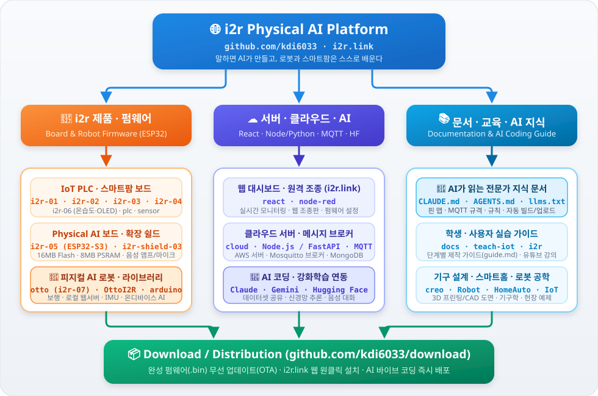

  

  <a href="https://i2r.link">🌐 공식 홈페이지</a> &nbsp;&nbsp; | &nbsp;&nbsp;
  <a href="https://i2r.link/products">🛒 i2r 제품구매</a> &nbsp;&nbsp; | &nbsp;&nbsp;
  <a href="https://www.youtube.com/@i2r-link">▶️ YouTube</a>

---

## 🔷 i2r 의미?

**i2r**(아이투알)은 **idea to real**, 즉 **아이디어를 현실로** 만든다는 뜻입니다.  
IoT PLC, 센서, 임베디드 시스템과 AI를 하나로 연결하는 **통합 플랫폼**으로, 단순한 예제 코드가 아닌 **현장 적용 · 교육 · 제품화**까지 고려한 실전형 아키텍처를 제공합니다.  
만들고 싶은 동작을 **말로 설명하면 AI가 코드를 작성**하고, 그 코드가 실제 보드에서 바로 동작합니다. 생각에서 동작까지의 거리를 줄이는 것이 i2r의 목표입니다.

---

## 📺 i2r 공식 채널 및 자료 링크
- 🛒 i2r 제품구매: href="https://i2r.link/products
- 💻 GitHub: https://github.com/kdi6033  
- 📺 YouTube: https://www.youtube.com/@i2r-link  
- 🌐 공식 사이트: https://i2r.link  
- 📧 문의: kdi6033@doowon.ac.kr

---
## 🗂️ i2r 플랫폼 아키텍처 (System Architecture)

i2r 플랫폼은 펌웨어, 서버, 문서, 배포 시스템이 하나로 연결된 **통합 생태계**입니다.  
각 저장소에는 학생과 사용자가 **배울 내용**이 담겨 있고, 같은 자료를 **AI도 읽을 수 있도록** 핀 맵, MQTT 규격, 라이브러리, 예제로 정리해 두었습니다.  
목표는 **AI가 이 자료를 읽고 i2r의 기술이 담긴 프로그램을 스스로 작성**하는 것입니다.

> 🤖 **AI에게 이렇게 요청하세요:** `https://raw.githubusercontent.com/kdi6033/kdi6033/main/llms.txt 읽고 i2r-03으로 온도 30도 넘으면 릴레이 1번 켜줘`  
> AI가 [llms.txt](llms.txt)에서 제품에 맞는 문서를 찾아 읽고 코드를 작성합니다.

  

## 🌐 i2r IoT & AI 플랫폼 통합 설명서 (Unified Guide)

**Physical AI · On-Device AI · IoT PLC · Edge Control**

- i2r은 **센서 → AI 판단 → 제어**를 하나의 Edge 루프로 묶은 **Physical AI 기반 IoT PLC 플랫폼**입니다.
- 센서 데이터는 클라우드와 연동하면서도, **판단과 제어는 현장(Edge)의 장치가 직접** 수행합니다.
- 산업 현장의 PLC와 액추에이터부터 교육용 로봇(Otto)까지, 아래 저장소에서 필요한 부분을 골라 사용할 수 있습니다.

## 🔷 1. IoT PLC (Physical · On-Device AI · Edge Controller Lineup)

- 산업 현장에서 사용되는 **ESP32 기반 IoT PLC / Physical AI Controller** 라인업입니다.  
- 센서 입력부터 판단, 출력 제어까지를 하나의 장치에서 처리하는 **Edge 제어 시스템**을 제공합니다.
- 모든 보드는 **Wi-Fi, Bluetooth, MQTT** 통신을 기본 지원하며,  
- 센서와 기기 간의 실시간 연동을 통해 **입력(Sensor) → 판단(AI) → 출력(Control)** 이 현장에서 즉시 수행됩니다.

| 리포지토리 명 | 주요 특징 및 사양 | 활용 분야 |
| :--- | :--- | :--- |
| **[i2r](https://github.com/kdi6033/i2r)** | Physical AI PLC 통합 아키텍처 및 MQTT 규격 | 시스템 통합 설계 가이드 |
| **[i2r-02](https://github.com/kdi6033/i2r-02)** | 사용하기 편한 범용 IoT PLC Core | 범용 IoT 제어기 기초 |
| **[i2r-03](https://github.com/kdi6033/i2r-03)** | 4채널 릴레이, 온습도 센서 연동 | 표준 산업용 PLC, 환경 모니터링 |
| **[i2r-04](https://github.com/kdi6033/i2r-04)** | 8채널 릴레이(8ch Relay) 제어 | 다채널 전력 제어, 스마트 팩토리 |

## 🔷 2. IoT Sensor · Actuator **(Physical World Interface)**

- IoT PLC 및 Edge Controller와 연동되어  
- 물리 세계의 상태를 **실시간으로 수집(Sensor)** 하거나  
- 실제 동작을 **직접 수행(Actuator)** 하는 장치 및 기술 계층입니다.

- 온·습도, CO₂, 조도, 전압, 전류 등 다양한 센서 데이터를 안정적으로 수집하고,  
- 수집된 데이터는 **On-Device AI를 통해 현장에서 즉시 분석·판단**되어  
- PLC 또는 액추에이터 제어로 바로 연결됩니다.

| 리포지토리 명 | 기술 스택 | 설명 |
| :--- | :--- | :--- |
| **[sensor](https://github.com/kdi6033/sensor)** | I2C, OneWire, Analog | **IoT Sensor 중심 Physical AI 계층**으로, 온·습도, CO₂, 조도, 전압, 전류 등 다양한 센서를 안정적으로 수집·처리하고, 수집된 데이터를 **On-Device AI가 현장에서 즉시 분석·판단**할 수 있도록 제공 |

## 🔷 3. Physical AI & On-Device Control (Communication · Edge Node · Arduino Platform)

- IoT PLC를 구성하고 확장하기 위한 **Physical AI 및 On-Device 제어 기술 플랫폼**입니다.
- ESP32 및 Arduino 기반 보드를 활용하여 센서 데이터 처리, 통신, AI 판단, 장치 제어를 **클라우드 의존 없이 현장(Edge)에서 직접 구현**할 수 있도록 설계되었습니다.
- **입력(Sensor) → 판단(AI) → 출력(Control)** 이 하나의 연속된 Edge 제어 루프로 동작하며, UI 기반 설정을 통해 **코드 작성 없이(No-Code)** 센서 조건과 제어 규칙을 구성할 수 있습니다.

| 리포지토리 명 | 기술 스택 | 설명 |
| :--- | :--- | :--- |
| **[IoT](https://github.com/kdi6033/IoT)** | C++, MQTT, HTTP, Phytyon | 산업 현장에서 사용되는 **ESP32 기반 Edge Controller 계층**으로, Wi-Fi·Bluetooth·RS-485·MQTT 통신을 통해 각종 엣지 컴퓨터, 컨트롤러, 외부 시스템과 연결되며 **On-Device AI 판단 결과를 현장 제어로 전달** |
| **[i2r-01](https://github.com/kdi6033/i2r-01)** | Arduino, C++, MQTT, Phytyon | 기초 입출력 및 통신 테스트용 Edge Node, IoT 통신 연결 |
| **[i2r-05](https://github.com/kdi6033/i2r-05)** | Arduino, C++, MQTT, Phytyon | 아두이노 보드, ESP32-S3, 16M Flash, AI 연산 가능  Physical AI / Edge AI |
| **[plc](https://github.com/kdi6033/plc)** | C++, Modbus, Ladder Logic 응용 | **On-Device AI 판단 결과를 실행하는 제어 계층**으로, 센서 기반 AI 판단에 따라 PLC 출력, 액추에이터, 타사 PLC(LS산전 등)를 직접 제어하여 **입력 → 판단 → 출력**의 Edge 제어 루프를 완성 |

## 🔷 4. Programming & Frameworks
하드웨어 구동을 위한 핵심 라이브러리와 통신 프로토콜 모음입니다.

| 리포지토리 명 | 기술 스택 | 설명 |
| :--- | :--- | :--- |
| **[arduino](https://github.com/kdi6033/arduino)** | C++, LVGL, MQTT | ESP32 Physical AI PLC 펌웨어, LVGL HMI |
| **[HomeAuto](https://github.com/kdi6033/HomeAuto)** | C++, Smart Home | Physical AI 기반 홈 자동화 예제 |

## 🔷 5. Server · UI · Data Science (IoT Intelligence Layer)
데이터를 수집, 시각화하고 AI로 분석하기 위한 플랫폼 레이어입니다.

| 리포지토리 명 | 기술 스택 | 설명 |
| :--- | :--- | :--- |
| **[react](https://github.com/kdi6033/react)** | React.js, JavaScript | 웹 기반 모니터링 UI 및 AI 데이터 분석 |
| **[teach-iot](https://github.com/kdi6033/teach-iot)** | Curriculum | IoT 및 스마트 팩토리 AI 서버구축 교육용 강의 자료 |
| **[node-red](https://github.com/kdi6033/node-red)** | JavaScript, HTML, Flow | MQTT 기반 실시간 대시보드 및 제어 흐름 |
| **[cloud](https://github.com/kdi6033/cloud)** | AWS, IBM Cloud, MQTT | 클라우드 서버 연동 및 데이터베이스 저장 |
| **[docs](https://github.com/kdi6033/docs)** | HTML, Markdown | 전체 시스템 사용 설명서 및 문서화 |
| **[download](https://github.com/kdi6033/download)** | Binary Files | 각 제품의 최신 펌웨어 다운로드 센터 |

## 🔷 6. Education, Robot & Design
전문 분야 응용 및 교육용 프로젝트 리포지토리입니다.

| 리포지토리 명 | 기술 스택 | 설명 |
| :--- | :--- | :--- |
| **[Robot](https://github.com/kdi6033/Robot)** | Kinematics, C++ | 로봇 제어 |
| **[otto](https://github.com/kdi6033/otto)** | C++, 3D Print | 교육용 이족 보행 로봇(Otto Robot) 프로젝트 |
| **[creo](https://github.com/kdi6033/creo)** | CAD | 기구 설계 및 CNC/3D 프린팅 가공 데이터 |

---

© 2024 kdi6033. All Rights Reserved.
